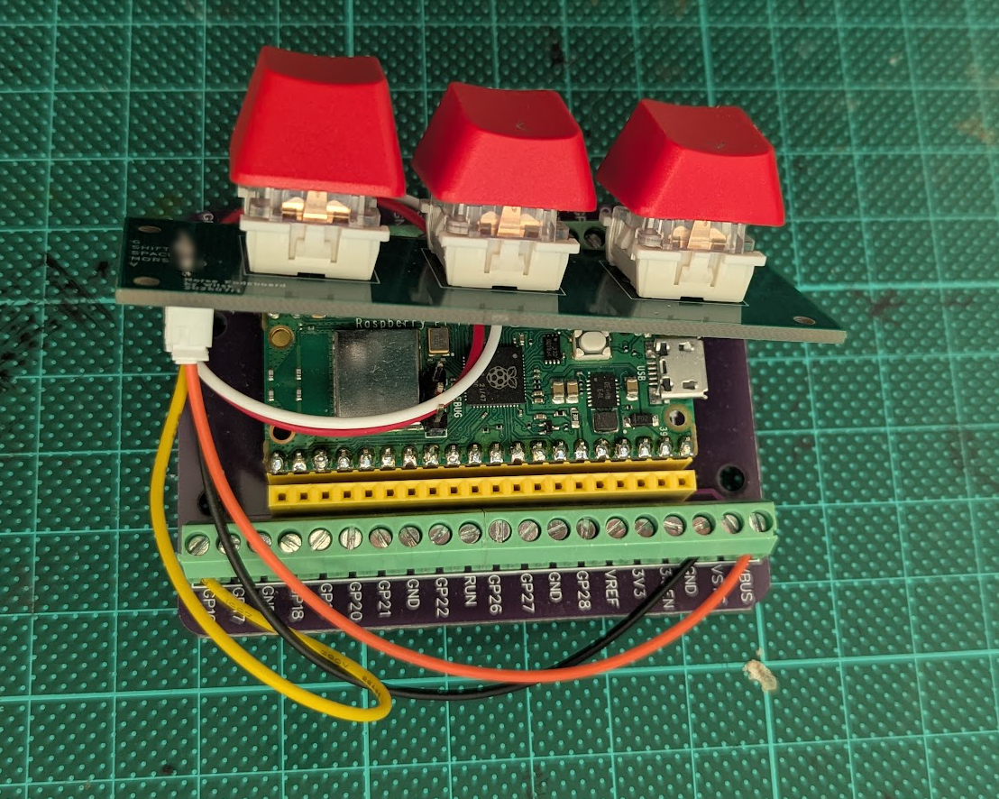
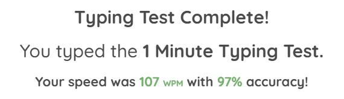
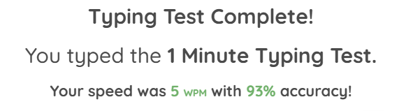

+++
title = "Morse Kodeboard - a Morse Code Keyboard"
description = "The Morse Kodeboard is a custom USB-HID keyboard that turns morse code into keyboard inputs."

[taxonomies]
tag = ["projects", "electronics"]

[extra]
show_toc = true
+++

Welcome to another project in a long line of "I don't know why I'm doing this"
projects!

A while back my family and I spent a week in coastal Victoria as I was
running[^1] the Great Ocean Road Marathon. While we were there we visited the
[Cape Otway Lightstation](https://www.lightstation.com), which was an important
lighthouse that helped guide ships through the rough seas that slam into the "Shipwreck Coast".

The Lightstation was also a key part of a 400km long telegraph cable that connected
Tasmania to the Australian mainland in the 1850s. In one of the buildings we
spotted a morse code table. I copied down some of the morse code and my kids
spent a happy half the long drive back decoding a message written in `dits` and `dahs`.

A few weeks later, I was chatting to a friend about my weakness for clicky,
tactile interfaces and input devices. In my excitement I got a bit careless in
my typing and was forced to defend my accuracy. I claimed I was "I'm typing on
my Morse Code keyboard" and then a moment later  realised I'd found my next
silly electronics project.

The idea was simple - a single button keyboard that you tap in either long or
short pulses and the keyboard outputs the correct letters over the USB port.

I decided to call this innovative and highly efficient device a:

**—— ——— ·—· ··· · | —·— ——— —·· · —··· ——— ·— ·—· —··**[^2]

You can find the source code + hardware files at <https://github.com/will-hart/morse-kodeboard>,
written in rust for the Rapsberry Pi Pico.

## Initial build

As this project was a bit of a meme, I didn't really want to over-engineer it.
I've already made quite a few USB-HID interfaces using rust firmware, and I have
a few RaspberryPi Picos sitting around. So the logical choice was to throw together
some [embassy](https://embassy.dev/) firmware and use a third-party morse code
library to convert the button presses to keyboard inputs. I started by building
a simple breadboard circuit and had a working keyboard up and running in a
couple of evenings.

As usual I had some issues with getting USB descriptors sorted, which
in this case turned out to be because I had a few loops without any "idle"
mechanism, which presumably meant they were hogging 100% of the
microcontrollers clock cycles and didn't respond to USB messages in time (or
ever). This was a fairly easy fix with embassy as I was able to throttle the
loops using a `Ticker`.

```rust
// set up a ticker somewhere at the top of a task
let mut ticker = Ticker::every(Duration::from_millis(1));

// do something

// wait for the next tick
ticker.next().await;
```

## Morse Code Decoding

The next challenge was decoding the button presses into characters. I initially
found a few libraries on crates.io and ran with those, and a couple of these
even supported `no-std`. Unfortunately I found that these libraries didn't quite
work in my use case. I wanted the reader to continuously check if a valid character
had been received, but most libraries were designed as "one-shot", where they're
passed a string of dots and dashes and immediately return a result. This made it
difficult to "stream" data from the button input. For example, if I wanted to
type `s` (···), then when I polled the decoder in a loop, I'd get `e e e` (· · ·).

So instead I decided to implement my own decoder, which can be found
[on the GitHub](https://github.com/will-hart/morse-kodeboard/blob/main/src/decoder.rs).

Its a fairly basic bit of code that has a "dit time" specified, is fed high and
low edges of a button and converts that into pulse durations and gaps. It then
stores these as *dits*, *dahs* and *breaks* (i.e. long pauses) in a ring buffer.
When polled, the buffer is matched against a set of acceptable characters using
and if a match is found it resets the ring buffer and returns the character.

For example here is the pattern for the first few characters:

```rust
if let Some(c) = match self.value_buffer {
            [Dit, Dah, Break, Empty, Empty, Empty] => Some('a'),
            [Dah, Dit, Dit, Dit, Break, Empty] => Some('b'),
            [Dah, Dit, Dah, Dit, Break, Empty] => Some('c'),
            ///...
} {
  // reset the ring buffer
  // handle a character
}
````

Using this approach made decoding a lot simpler. A task could be set up to watch
the morse code button, feed the inputs to the decoder and do the USB keyboard
stuff when a character match was found via another task. Message channels were
used for communicating between tasks.

## More keys?

At this point I realised a few fundamental issues with the one button approach.
For starters, without a space bar it is very hard to write more than one very long
word. So adding a space key was the first bit of scope creep. Secondly, without
a shift key, it was very hard to add punctuation. This might have been OK in the
days when morse code was in regular use. Sadly in this more refined modern age
(i.e. the age of being corrected on the internet)  I'd love to be able to type
*most* things without being told off for poor spelling.

So the scope was crept again and a Shift key was added. Just like that, a one
key keyboard had been "upgraded" into a three key keyboard[^3] - a "morse" key,
a shift key and a space key. This in turn meant the firmware now had a lot of
different tasks spawned:

1. A `usb_loop` that manages the underlying USB interface
2. A `usb_hid_loop` that manages writing to the USB HID interface
3. A `usb_request_handler` that manages incoming requests from the host PC on
   the USB HID interface
4. A `monitor_space_key` task that watches the space button and generates ' '
   characters for the USB HID loop to send
5. A `generate_morse_code_characters` task, that watches the `shift` and `morse`
   keys and generates the appropriate morse code characters for the `usb_hid_loop`
   to send.

The whole thing is tied together with a series of bounded embassy `Channel`s.

Here is a video of the firmware running on a breadboard device with a debugger
attached:

<video controls muted loop preload="metadata" width="640" height="480" style="margin: -2rem auto 3rem auto;">
  <source src="morse_code_example.webm" type="video/webm">
  Your browser does not support the video tag.
</video>

## Building the hardware

As much as this was a meme project, I felt like adding some hardware would be
nice. Greed may have played a part as well because I saw this device absolutely
flying off the shelves. I figured as this was a keyboard (and I have some
hardware lying around) that using hot-swappable mechanical switches would be a
good first step[^4].

From here making a PCB in Kicad was pretty straightforward, its a connector,
three mechanical switches (using hot-swappable sockets) and a few 0603 pull-up
resistors. It took maybe an hour, then I sent of the gerbers off to my Chinese
fab of choice. A week later I clutched a Morse Kodeboard PCB in my hand, and all
for less than a tenner.

Soldering was very straightforward (for a couple of resistors I don't even
bother with my reflow setup) and took maybe 20 minutes by hand. I have to admit
 to doing a pretty poor job of the connectors[^5] and I didn't have any
right-angled JST connectors which made the whole thing fit together awkwardly.

The resulting Frankenstein looks like this:



## Typing performance

OK, I know what you're really here to see is how fast you can type on a Morse
Kodeboard. To keep this comparison fair, I think some benchmarking is in
order. There are lots of random typing speed tests on the internet, so let's try
to see how fast I can type on the Kodeboard vs a regular keyboard. 

First the control, typing on my Keychron K8:



Hmmmm I seem to be slowing down in my old age. My kids do tell me I hit the
delete key most of the time so possibly I normally type twice as fast with half
the accuracy and because of the pressure I was being careful. Actually, that
makes me think - I don't actually have a delete key on the Kodeboard!

Well, we're in too deep now to go back, so I'll just have to be perfect.

And the Kodeboard results are in:



The Kodeboard is about 20x slower, but around the same accuracy if you squint.
So I guess if you count the additional swag you gain from rolling up and typing
in morse code, we will call this competition a tie (or should I say a `— ·· ·`)?

## What next?

I'm not sure there should be anything next to be honest!

I guess one thing that could really jazz this up would be an enclosure. Mulling
it over, I have a few options here[^6]

1. Butcher an electronics project box (maybe a laser cut top),
2. Print or laser cut a fully custom enclosure,
3. Look at a more traditional morse code key, of which it seems there are a wide
   [variety of types](https://hamuniverse.com/n2eycodekeys.html)

I could see some other features being added like:

1. A rotary encoder to set the duration of a `dit` (i.e. how fast you have to tap)
2. A delete button
3. Some LEDs indicating i.e. when "shift" is down (actually its more like Capslock)

A this point though I think I've made my point, whatever that is. I think this
one may just end up in a project box next to my desk, so I'll call it a day.

## Notes

[^1]: "Running" may be a bit of a stretch in describing my pace after the 36km marker.
[^2]: Morse Kodeboard, as you may have guessed.
[^3]: Spoiler, its probably going to need more than three keys.
[^4]: Eventually it would be nice perhaps to build a more old-fashioned morse-code style interface, but for now this is still a "keyboard" in the modern sense.
[^5]: The offending soldering work is blurred for your safety.
[^6]: The best option was suggested by a friend - a belt mounted Morse Keyboard with one of those a retractable USB cables. That way you're always prepared whenever you find a computer without a keyboard you can just zip out your USB cable and hook in!
